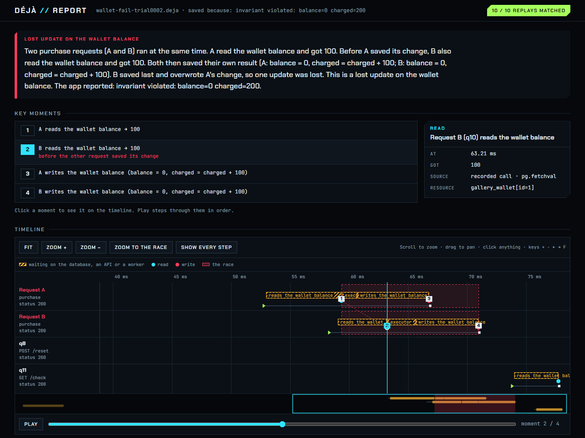

# Déjà

Replay the asyncio race condition you couldn't reproduce.

Déjà records the real scheduling order of a running asyncio app (which task ran when, what each database and HTTP
call returned, what the clock and random number generator said) and replays it on your laptop with a deterministic
event loop. The bug that only happened when two requests overlapped in production happens again, every time, with
no database or network needed.



> Status: working end to end for ASGI apps (FastAPI, Starlette) on CPython 3.12 and 3.14, tested on Linux, Windows
> and macOS. Not production-hardened yet; see [what's not covered](#not-covered-yet).
> Design and prior art: [docs/DESIGN.md](docs/DESIGN.md) · Architecture and decisions: [docs/ARCHITECTURE.md](docs/ARCHITECTURE.md) ·
> Feasibility spikes: [spikes/RESULTS.md](spikes/RESULTS.md) · Benchmarks: [benchmarks/RESULTS.md](benchmarks/RESULTS.md) ·
> Race gallery: [gallery/README.md](gallery/README.md)

## Try it

```bash
pip install -e ".[dev,gallery]"

# record: run the race gallery on Déjà's recording loop; every trial that breaks its invariant is saved
python -m gallery.stress wallet --trials 50 --record recordings/

# see it: the requests and the exact interleaving that caused the double charge
deja show recordings/wallet-fail-trial0003.deja
deja report recordings/wallet-fail-trial0003.deja --app gallery.wallet:create_app   # HTML, with a replay verdict

# replay it 100 times: same interleaving, same double charge, every time
deja replay recordings/wallet-fail-trial0003.deja --app gallery.wallet:create_app --times 100
```

In your own app:

```python
import deja
app.add_middleware(deja.DejaMiddleware, directory="deja-recordings")   # saves on 5xx, exception, or deja.flag()
# uvicorn app:app --loop deja.loop:recording_loop
```

Replay with the app configured the same way it was recorded (same store, same feature flags). If the code or its
configuration takes a different path, Déjà reports where the replay diverged instead of pretending it matched.

## How it works

1. **Record.** A subclass of the standard asyncio event loop logs which task each loop pass ran (one integer per
   step, so recording is cheap), with stable task ids derived from where each task was created. A middleware marks
   each HTTP request and each WebSocket connection as request scope, and adapters for asyncpg (including SQLAlchemy
   async, transactions, cursors, bulk copy and LISTEN/NOTIFY), httpx (including streamed bodies, chunk by chunk),
   redis and WebSocket messages record what each call returned. Plain `def` endpoints and `asyncio.to_thread` run in
   worker threads; what those threads do to shared state is recorded under the request too. Everything sits in a
   fixed-size ring buffer; a 5xx, an exception, close code 1011 or `deja.flag()` saves the window around the failing
   request to a small `.deja` file.
2. **Explain.** The report names the race (lost update, check-then-act, stale read), the two requests and the order
   of their reads and writes. It finds them in SQL (rows, ranges evaluated against the recorded data, subqueries,
   transactions counted at commit), Redis keys, outside HTTP calls and the app's in-memory state, which Déjà tracks
   on its own: containers and objects the routes' code can reach, and module variables it reassigns.
3. **Replay.** A replay loop with a virtual clock re-sends the recorded requests (and WebSocket messages) to a fresh
   copy of the app and only lets request tasks run in the recorded order. Database, HTTP and blocking calls get
   their recorded answers; worker threads run again and wait at each access to shared state until the recording
   says it's their turn.
4. **Check.** If the code no longer behaves as recorded (a task can't take its recorded step, or a query differs),
   replay stops and says where. Replaying a recorded race against a fixed version shows the fix blocks it.

## Results

Acceptance run (`python -m gallery.acceptance --recordings 5 --replays 100`), CPython 3.12 and 3.14:

| App | Bug in plain runs | Failing recordings replayed | Passing recordings replayed |
|---|---|---|---|
| signup (check-then-act) | 24% | bug in 500/500 | bug in 0/500 |
| likes (lost update) | 52% | bug in 500/500 | bug in 0/500 |
| wallet (double charge) | 37% | bug in 500/500 | bug in 0/500 |

The same holds with the apps on Postgres, including with the database container stopped before replaying.

Overhead (FastAPI + Postgres + an HTTP call per order, k6 at 100 to 400 req/s, GitHub Actions Linux, 2 vCPU):
throughput unchanged, no failed requests, about +12% server CPU, +1 to 3 ms at p99, about 0.1 KB of recording per
request. Details and method: [benchmarks/RESULTS.md](benchmarks/RESULTS.md).

## Why

asyncio code races at every `await`. Two requests read the same row, both pass the check, both write. In tests the
timing never lines up, so the bug "can't be reproduced". Existing tools record a single request sequentially,
simulate random schedules in tests, or profile where time goes. None of them capture the interleaving that actually
happened and play it back. ([prior art](docs/DESIGN.md#2-what-exists-checked-2026-11-07-primary-sources))

## Not covered yet

What Déjà can't decide, it says so ("possible conflict") rather than guess. The limits:

- **SQL conditions** are evaluated against what the recording shows: the rows a query returned and the values a
  write set. Values only the server knows (`now()`, defaults, sequences), functions Déjà doesn't evaluate, and rows
  no recorded query showed leave a conflict *possible*. A subquery can prove a row matched, never that none did.
- **Shared state** is found by following the routes' code. State held only by library objects, reached with
  computed names (`getattr(obj, name)`), objects stored inside containers (`accounts[7].balance`: the read of
  `accounts[7]` is reported, the attribute isn't), and classes with their own metaclass (pydantic models) need
  `deja.track(obj)` or `deja.touch`. A container that something else also holds (a default argument, a tuple) is
  left alone rather than split in two.
- **Worker threads** are ordered at their accesses to shared state; work in between runs freely, and an access made
  in the middle of an event-loop step replays just after it. Sync clients inside them (`requests`, psycopg,
  sync SQLAlchemy) are not recorded, so they run for real during replay. A thread that waits on the event loop
  (`anyio.from_thread`) between two accesses is released after the replay deadline.
- **Long WebSocket connections**: a recording keeps what fits in the ring buffer. A connection whose start fell out
  of it is left out of the replay; one still open when the recording was saved stays idle at its end.
- Postgres log and termination listeners; uvloop (record on the standard loop); free-threaded builds; Python
  versions other than 3.12 and 3.14.
- Overhead target of 5% CPU not reached yet (about 12% measured; a tracked access costs about 6 µs inside a
  recorded request and about 1 µs outside one).

## Requirements

Python 3.12 or 3.14. The import name is `deja`; the PyPI distribution will be `deja-replay` (`deja` is taken on PyPI).
