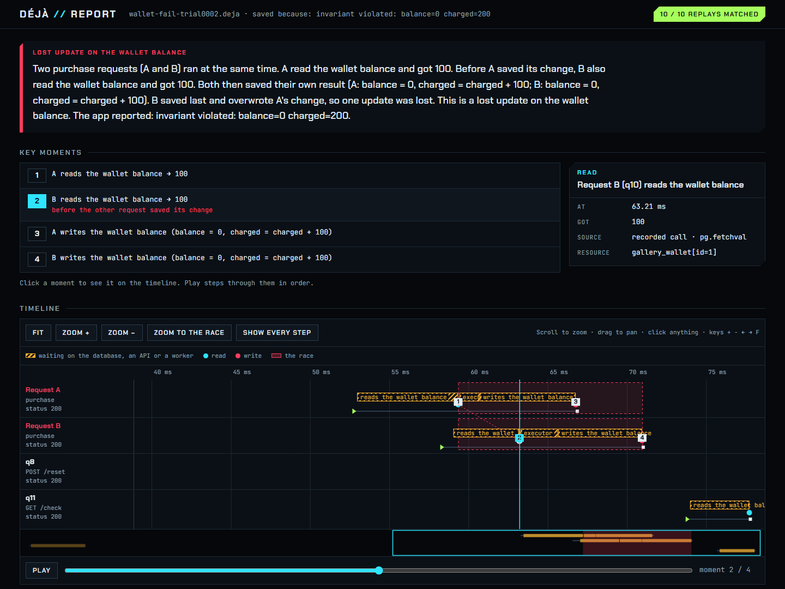

# Reading a report

`deja show` prints a recording's requests and interleaving in the terminal. `deja report` writes an HTML page that
explains the race. Both read only the recording; neither needs your app, unless you ask the report for a replay
verdict.

```bash
deja report recording.deja                          # the analysis only
deja report recording.deja --app myapp:create_app   # plus a replay verdict
```

The page is written next to the recording (`recording.html`), or where `-o` says.



## The story

The top of the page says what went wrong, in plain words, generated from the recording (no AI involved):

> Two purchase requests (A and B) ran at the same time. A read the wallet balance and got 100. Before A saved its
> change, B also read the wallet balance and got 100. Both then saved their own result (A: 0; B: 0). A saved last
> and overwrote B's change, so one update was lost. This is a lost update on the wallet balance.

Its heading names the [pattern](../how-it-works.md#analysis) and the resource: *Lost update on the wallet
balance*. The two requests in the race are called **A** and **B** everywhere on the page. If the recording holds
more than one race, a button per race switches the story, the moments and the timeline between them.

### Certain and possible

A race is **certain** when the recording proves both requests touched the same thing: the same key, the same
object attribute, a SQL row identified by its key. It is **possible** when Déjà can't decide, for example when a
SQL condition depends on something only the database knows (`now()`, a default, a trigger). A possible race is
shown as "Possible lost update on ...". Treat it as a lead to check, not a verdict. [Limits](../limits.md) lists
what makes a conflict possible rather than certain.

## Key moments

The reads and writes that make up the race, numbered, in the order they happened:

1. A reads the wallet balance → 100
2. B reads the wallet balance → 100
3. B writes the wallet balance (0)
4. A writes the wallet balance (0)

Click a moment to see it on the timeline, or press **Play** to step through them.

## Timeline

One lane per request (A and B first), time left to right. Hatched bars are waits on the database, an API or a
worker thread; dots are reads and writes; the shaded band is the race. **Show every step** adds a bar for each
step the event loop ran. Scroll to zoom, drag to pan, and click anything for its details in the side panel; the
keys `+`, `-`, `←`, `→` and `F` (fit) work too.

## What each request touched

A table with one row per resource and one column per request. A cell lists that request's accesses to the resource
in order, with the time in milliseconds. Click a row to show only that resource on the timeline.

## Replay

With `--app`, the report replays the recording `--times` times (20 by default) and shows how many replays matched,
in the header (*20 / 20 replays matched*) and in full at the bottom. Without `--app` it shows the command to run.

## Give things readable names

Reports use the names Déjà finds: routes (`POST /purchase`), outside calls (`POST payments/charge`), state
(`wallet.balance`). [`deja.labels`](../reference/python-api.md#deja.labels) renames them for the report:

```python
deja.labels({
    "POST /purchase": "purchase",
    "wallet.balance": "the wallet balance",
})
```

The analysis treats an outside HTTP call as a read of the remote resource if its method is GET or HEAD, and as a
write otherwise. When that's wrong for one of your APIs, say so with
[`deja.calls`](../reference/python-api.md#deja.calls):

```python
deja.calls({
    "POST pricing.internal/quote": "read",      # a POST that only computes a price
    "GET metrics.internal/*": "ignore",         # not part of the story
})
```

Both only change the report; call them once at startup.
