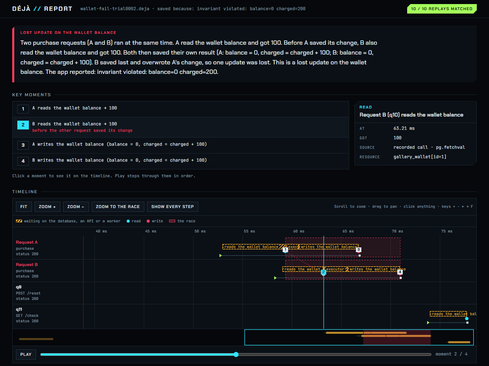

# Déjà

**Replay the asyncio race condition you couldn't reproduce.**

Déjà records the real scheduling order of a running asyncio app: which task ran when, what each database and HTTP
call returned, what the clock and the random number generator said. It replays that order on your laptop with a
deterministic event loop. The bug that only happened when two requests overlapped in production happens again, every
time, with no database or network needed.



## The problem

asyncio code can be interrupted at every `await`. Two requests read the same balance, both see enough money, both
charge the card. In tests the timing never lines up, so the bug "can't be reproduced", and the logs only show that
it happened, not the order that caused it.

## What Déjà does

1. **Records** each request's steps and the answers to its calls while the app serves traffic, in a fixed-size
   ring buffer. When a request fails, it saves the window around it to a small `.deja` file.
2. **Explains** the race in plain words: which requests, which piece of state, in what order they read and wrote it.
3. **Replays** the recording against a fresh copy of your app, in the recorded order, as many times as you like.
4. **Checks a fix**: replay the recorded race against the changed code and see whether it still happens.

```console
$ deja replay wallet-fail.deja --app gallery.wallet:create_app --times 3
followed 10/10 recorded steps
  request 0: recorded 200 {"ok":true} | replayed 200 {"ok":true}  [same]
  request 1: recorded 200 {"ok":true} | replayed 200 {"ok":true}  [same]
  request 2: recorded 200 {"ok":true} | replayed 200 {"ok":true}  [same]
  request 3: recorded 200 {"violated":true,"detail":"balance=0 charged=200"} | replayed 200 {"violated":true,"detail":"balance=0 charged=200"}  [same]

3/3 replays matched the recording
```

## Where it works

| | |
|---|---|
| **Apps** | ASGI apps (FastAPI, Starlette, Litestar, Quart, Django), aiohttp servers, queue consumers and scheduled jobs, WebSocket connections, several worker processes |
| **Libraries** | asyncpg, SQLAlchemy async, psycopg 3, aiomysql, aiosqlite, redis, PyMongo async, aiobotocore and boto3, aiokafka, httpx, aiohttp client, requests, grpc.aio; see [Supported libraries](reference/adapters.md) |
| **Python** | CPython 3.12, 3.13, 3.14 and 3.15, PyPy 3.12; Linux, Windows and macOS |

Déjà is pre-1.0. It works end to end on the apps above but has not been hardened in production yet; [Limits](limits.md)
lists what it can't do.

## Where to go next

- [Getting started](getting-started.md): install, record a race from the bundled gallery, replay it, then add
  Déjà to your own app.
- [How it works](how-it-works.md): recording, analysis and replay, in one page.
- [Fixing a race](guides/fixing-races.md): from a recording to a verified fix and a regression test.
- [Command line](reference/cli.md) and [Python API](reference/python-api.md): every command, option and function.
